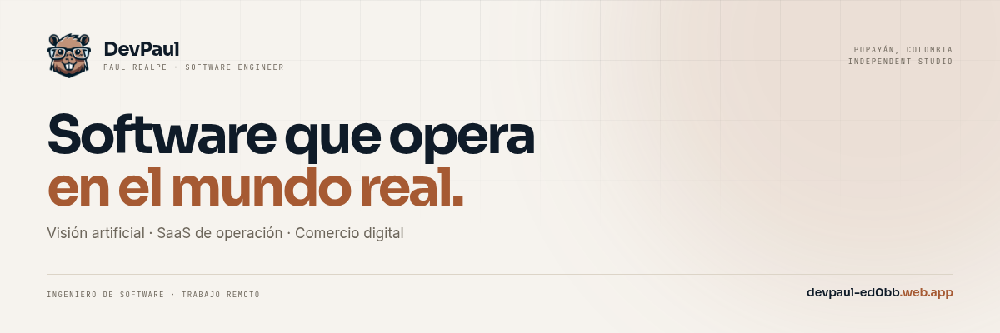

  

<h1 align="center">Paul Realpe</h1>

  <strong>Senior Software Engineer &amp; Founder of DevPaul</strong> 
  Popayán, Colombia · Remote work

  
  
  
  

---

I design, build and operate critical software systems: **computer vision, operations platforms and digital products**. More than seven years shipping software from the first requirement to production and on-site operation.

I am the founder of **DevPaul**, my product and engineering studio. I work with my brother **Jimmy Realpe** on selected projects and with a small senior team: fewer layers, faster decisions and direct accountability for every system we put into production.

> **2026:** refreshed the **DevPaul** portfolio around production systems, capabilities and measurable delivery.

## Current focus

- **Computer vision in production** — detection, OCR and video analytics on edge devices, integrated with VMS and alert workflows.
- **Operations platforms** — offline-first SaaS, complex business rules, role-based access and audit trails.
- **Product engineering** — web and mobile applications where reliability, performance and maintainability matter.
- **Applied AI** — agents, RAG and automation over business data, with human oversight and traceability.

## DevPaul

**DevPaul** is my product and engineering studio: computer vision, operations SaaS and digital commerce. Four systems in production.

[devpaul-ed0bb.web.app](https://devpaul-ed0bb.web.app)

Alongside DevPaul, I co-founded **RealNeers** with my brother [Jimmy Realpe](https://jimmy-realpe.web.app): an engineering firm with a bilingual portfolio of 21 projects across computer vision, product, web and mobile. [realneers.web.app](https://realneers.web.app)

## Selected work

| Project | Domain | Stack | Status |
|:--|:--|:--|:--|
| **Parking Management** | Multi-site parking operations, offline-first | Flutter · Supabase · PostgreSQL | Private |
| **DevPaul Loans** | Credit portfolio and collections | Flutter · Firebase · Cloud Functions | [Live](https://loansdevpaul.web.app) |
| **Vehicle inspection** | Plate, damage and scratch detection with automatic forms | Flutter · Python · OCR · Firebase | [Live](https://cda-popayan.web.app) |
| **Vehicle & event detection** | Edge AI analytics for surveillance and VMS | Python · YOLO · TensorRT · Jetson | Private |
| **Adhara IceCream** | Digital menu and WhatsApp commerce | Flutter Web · Supabase · Hive | [Live](https://adhara-icecream.web.app) |
| **Amor Eterno** | Online store for a textile atelier | Flutter Web · Supabase · Hive | [Live](https://amor-eterno-mercaderes.web.app/) |
| **DevPaul ToDo** | Task management with semantic search | Flutter · n8n · PostgreSQL · pgvector | [Live](https://devpaultodo.web.app) |

## Flagship systems

**Parking Management** — offline-first operations for multi-site parking companies. Check-in, rates, cash reconciliation and photo/video evidence.  
`993 tests` · `79 migrations` · sync outbox with idempotency.

**DevPaul Loans** — credit and collections for lenders who need to replace the paper ledger. Loans, payments, renewals, arrears and per-collector settlement.  
`984 tests` · `multi-tenant` · roles, audit trail and numbered receipts.

**Computer vision platform** — damage, people, object and plate detection on existing IP cameras. On-premise inference on NVIDIA Jetson, evidence capture and VMS integration.  
`local inference` · `plate OCR` · `production operation`.

## Capabilities

- **Computer vision:** detection, OCR, video analytics, edge inference, RTSP/ONVIF, VMS integration.
- **Operations platforms:** SaaS, offline-first workflows, PostgreSQL/RLS, roles, audit and reporting.
- **Digital products:** Flutter, React, Angular, Astro, accessible interfaces and performance budgets.
- **Applied AI:** agents, RAG, embeddings, local LLMs, n8n workflows and human-in-the-loop review.

## Stack

| Area | Technologies |
|:--|:--|
| **Languages** | Python, TypeScript, Dart, Go, SQL |
| **Vision & edge** | YOLO, TensorRT, OpenCV, VLM, OCR, Jetson, RTSP/ONVIF, VMS |
| **Backend & data** | FastAPI, Node.js, NestJS, PostgreSQL, Supabase, Firebase, pgvector |
| **Frontend & mobile** | Flutter, React, Angular, Astro, Next.js, Tailwind CSS |
| **Platform & DevOps** | Docker, CI/CD, Linux, Nginx, Azure, AWS, Google Cloud |
| **Identity & integration** | Zitadel, OpenFGA, OIDC, JWT, APIs, n8n |

## How I work

- **Verifiable requirements:** every initiative starts with a business objective and measurable acceptance criteria.
- **Quality from day one:** TDD, contract tests and code review; quality is not negotiated at the end.
- **Maintainable architecture:** the domain stays independent of frameworks so infrastructure can change without a rewrite.
- **AI with oversight:** automation accelerates delivery; product decisions and final validation remain human.

## Portfolio & CV

- 🌐 **DevPaul — portfolio and selected work:** [devpaul-ed0bb.web.app](https://devpaul-ed0bb.web.app)
- 📄 **Technical CV:** [github.com/paulmrg-461/cv-paul-realpe](https://github.com/paulmrg-461/cv-paul-realpe)

## Connect

  
  
  
  

---

  <strong>Open to selected engineering engagements.</strong> 
  <a href="mailto:co.devpaul@gmail.com">co.devpaul@gmail.com</a> · <a href="https://devpaul-ed0bb.web.app">devpaul-ed0bb.web.app</a>

